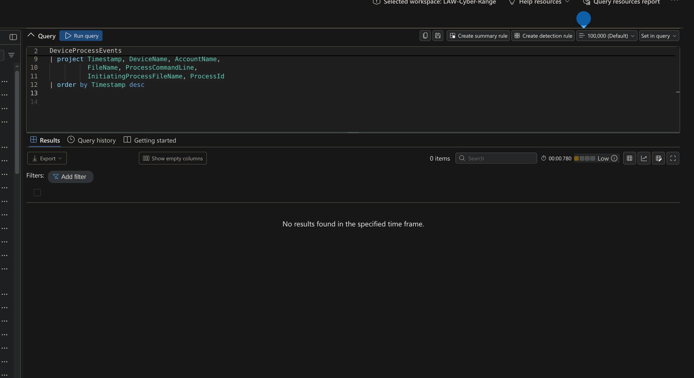
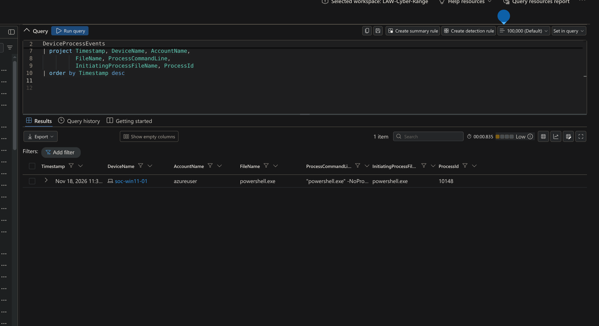
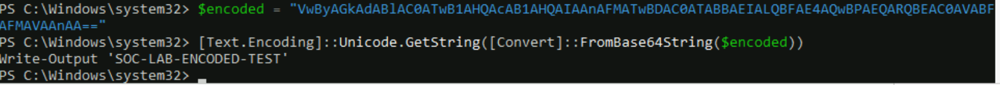

# IR-001: Encoded PowerShell Execution Investigation

**Investigation Date:** November 18, 2026  
**Environment:** Azure Cyber Range — Windows 11  
**Endpoint:** SOC-WIN11-01  
**Security Platform:** Microsoft Defender for Endpoint / Defender XDR  
**Investigation Type:** Controlled detection validation  
**Disposition:** Authorized simulation — No malicious activity identified

## 1. Executive Summary

A controlled PowerShell execution test was conducted on a Windows 11 virtual machine to validate endpoint telemetry collection and investigate encoded command execution using Microsoft Defender Advanced Hunting.

The test generated a PowerShell process using the `-EncodedCommand` argument. Defender recorded the execution in the `DeviceProcessEvents` table, allowing the activity to be identified and examined.

The encoded command was subsequently decoded and confirmed to contain a harmless test statement.

## 2. Environment

- Azure-hosted Windows 11 virtual machine
- Microsoft Defender for Endpoint onboarded and reporting an active sensor
- Sysmon installed with process creation, network connection, file creation, and DNS query logging
- Microsoft Defender Advanced Hunting used for investigation

## 3. Detection Methodology

The investigation focused on PowerShell process creation events containing the `-EncodedCommand` argument.

The following KQL query was used to identify the simulated activity:

```kql
DeviceProcessEvents
| where Timestamp > ago(2h)
| where DeviceName == "soc-win11-01"
| where FileName =~ "powershell.exe"
| where ProcessCommandLine contains "-EncodedCommand"
| project Timestamp, DeviceName, AccountName,
          ProcessCommandLine, InitiatingProcessFileName,
          ProcessId
| order by Timestamp desc
```

The query identified one matching process execution event.

## 4. Investigation Findings

The event contained the following information:

| Field | Observed Value |
|---|---|
| Device | soc-win11-01 |
| Account | azureuser |
| Process | powershell.exe |
| Parent process | powershell.exe |
| Process ID | 10148 |
| Execution argument | -EncodedCommand |

The parent-child process relationship and command-line arguments were examined to understand how the test command was executed.

## 5. Payload Analysis

The Base64-encoded PowerShell argument was decoded using PowerShell's Unicode decoding functionality.

The resulting command was:

```powershell
Write-Output 'SOC-LAB-ENCODED-TEST'
```

The decoded command only prints a test string. No malicious functionality was identified in the decoded payload.

## 6. MITRE ATT&CK Mapping

**T1059.001 — Command and Scripting Interpreter: PowerShell**

This investigation demonstrates how PowerShell command-line telemetry can support the identification and analysis of encoded execution.

Encoded PowerShell execution is not inherently malicious. Additional context is necessary to distinguish legitimate administrative activity from suspicious behavior.

## 7. Conclusion

The test successfully demonstrated endpoint telemetry collection, process-level investigation, and Base64 payload decoding using Microsoft Defender.

The activity was authorized and did not require containment or remediation.

This exercise establishes a foundation for future detection engineering and incident response investigations involving Windows endpoints.

## 8. Evidence

### Evidence 1 — Detection Baseline

The initial Advanced Hunting query returned no matching events
before the controlled PowerShell simulation.



### Evidence 2 — Encoded PowerShell Detection

Microsoft Defender identified the simulated PowerShell execution
using the `-EncodedCommand` argument.

The matching event was associated with endpoint `soc-win11-01`
and process ID `10148`.



### Evidence 3 — Payload Decoding

The encoded command was decoded using PowerShell's Unicode
and Base64 conversion functions.

The decoded payload was:

`Write-Output 'SOC-LAB-ENCODED-TEST'`

This confirmed the simulated activity was harmless.


