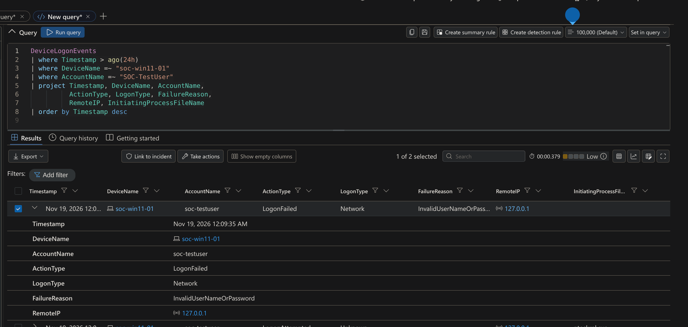
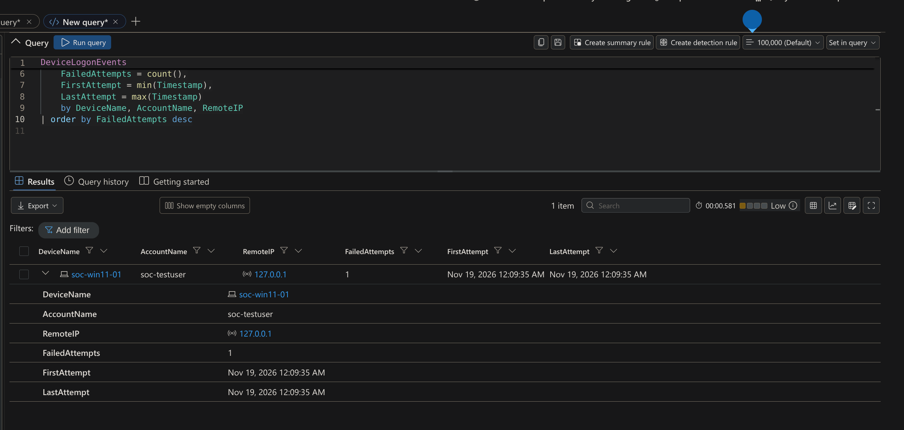
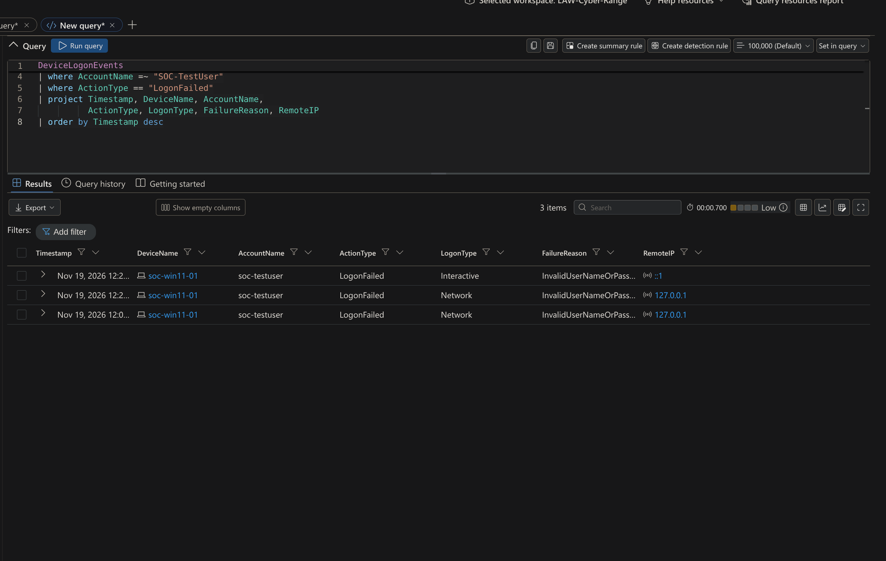
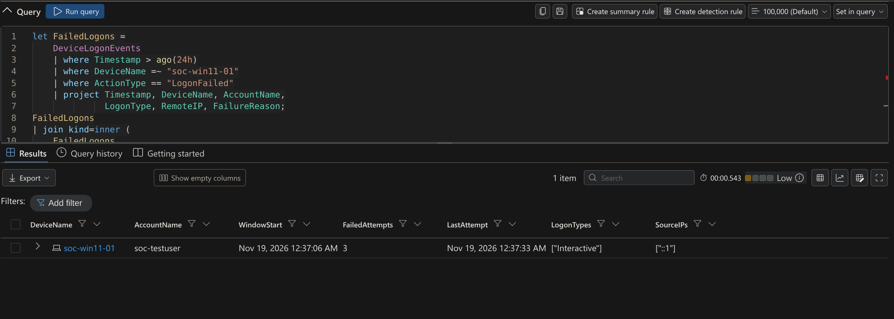

# IR-002: Windows Authentication Failure Investigation

**Investigation Date:** November 18–19, 2026  
**Environment:** Microsoft Azure Cyber Range  
**Endpoint:** SOC-WIN11-01  
**Security Platform:** Microsoft Defender for Endpoint / Defender Advanced Hunting  
**Investigation Type:** Authentication monitoring and detection engineering  
**Disposition:** Authorized simulation — No confirmed malicious activity

## 1. Executive Summary

A controlled authentication testing exercise was conducted on a Windows 11 virtual machine to investigate failed logon activity and validate detection capabilities.

A dedicated local test account, `SOC-TestUser`, was used to generate unsuccessful network and interactive authentication attempts.

Windows Security Event ID 4625 was examined to identify the affected account, logon type, failure reason, and authentication status codes.

The corresponding events were investigated using Microsoft Defender Advanced Hunting. A KQL detection was developed to identify three or more failed logons within a rolling five-minute window.

The detection successfully identified three interactive authentication failures occurring within 27 seconds.

## 2. Investigation Environment

- Windows 11 virtual machine hosted in Microsoft Azure
- Microsoft Defender for Endpoint onboarded and active
- Windows Security auditing configured for successful and failed logons
- Local standard user account: `SOC-TestUser`
- Microsoft Defender Advanced Hunting
- Kusto Query Language (KQL)

Testing was limited to the authorized lab endpoint.

## 3. Initial Authentication Investigation

An unsuccessful network authentication attempt was generated using the Windows `net use` utility.

Windows Security recorded Event ID 4625 with the following details:

| Field | Observed Value |
|---|---|
| Account | SOC-TestUser |
| Device | SOC-WIN11-01 |
| Event ID | 4625 |
| Logon Type | 3 — Network |
| Failure Reason | Unknown user name or bad password |
| Status | 0xC000006D |
| Substatus | 0xC000006A |
| Source IP | 127.0.0.1 |

The substatus indicated an incorrect password.

Microsoft Defender also recorded the authentication failure in the `DeviceLogonEvents` table.

## 4. Interactive Authentication Investigation

An additional controlled authentication attempt was performed using the Windows `runas` utility.

The failed attempt generated another Windows Security Event ID 4625.

The investigation identified:

| Field | Observed Value |
|---|---|
| Account | SOC-TestUser |
| Logon Type | 2 — Interactive |
| Failure Reason | Incorrect password |
| Status | 0xC000006D |
| Substatus | 0xC000006A |
| Source IP | ::1 |
| Logon Process | seclogo |

The interactive event was subsequently observed in Microsoft Defender Advanced Hunting.

This demonstrated the ability to distinguish network authentication failures from interactive logon failures.

## 5. Telemetry Correlation

Windows Security logs and Microsoft Defender were compared to validate authentication telemetry collection.

Three initial failed-logon events were confirmed in the Windows Security log, with corresponding records subsequently appearing in Defender.

A delay was observed before the interactive authentication event became visible in Advanced Hunting.

The investigation highlighted the importance of validating security events against endpoint logs when cloud telemetry is not immediately available.

## 6. Detection Engineering

A KQL query was developed to identify repeated failed logons within a rolling five-minute window.

```kusto
let FailedLogons =
    DeviceLogonEvents
    | where Timestamp > ago(24h)
    | where DeviceName =~ "soc-win11-01"
    | where ActionType == "LogonFailed"
    | project Timestamp, DeviceName, AccountName,
              LogonType, RemoteIP, FailureReason;
FailedLogons
| join kind=inner (
    FailedLogons
    | project WindowStart = Timestamp,
              DeviceName, AccountName
) on DeviceName, AccountName
| where Timestamp between (WindowStart .. WindowStart + 5m)
| summarize
    FailedAttempts = count(),
    LastAttempt = max(Timestamp),
    LogonTypes = make_set(LogonType),
    SourceIPs = make_set(RemoteIP)
    by DeviceName, AccountName, WindowStart
| where FailedAttempts >= 3
| order by WindowStart desc
```

The query groups authentication failures by device and account and identifies periods containing at least three failures within five minutes.

This is a laboratory detection threshold and would require tuning before use in a production environment.

## 7. Detection Validation

### Negative Test

The initial authentication events occurred more than five minutes apart.

The detection query returned zero matching results.

This demonstrated that the query did not flag the widely spaced failures.

### Positive Test

Three controlled interactive authentication failures were generated using the dedicated test account.

Windows Security recorded the following events:

| Event | Local Timestamp |
|---|---|
| Failure 1 | 11:37:06 PM |
| Failure 2 | 11:37:25 PM |
| Failure 3 | 11:37:33 PM |

Microsoft Defender subsequently recorded the corresponding failures.

The rolling-window detection returned a matching result with:

- Account: `soc-testuser`
- Device: `soc-win11-01`
- Failed attempts: 3
- Logon type: Interactive
- Source IP: `::1`
- Elapsed time: 27 seconds

The positive test confirmed that the KQL query could identify the simulated repeated-authentication pattern.

No automated detection rule or alert was created during this exercise.

## 8. MITRE ATT&CK Mapping

**T1110 — Brute Force**

Repeated authentication failures can be associated with brute-force techniques.

The detection logic is intended to identify patterns that warrant further investigation.

The observed activity was an authorized simulation and does not establish that an actual brute-force attack occurred.

## 9. Findings and Recommendations

The investigation demonstrated successful collection and analysis of Windows authentication telemetry.

Key findings included:

- Windows Security Event ID 4625 provided detailed authentication failure information.
- Microsoft Defender recorded network and interactive failed-logon events.
- Cloud telemetry was not always immediately available.
- KQL aggregation enabled identification of repeated authentication failures.
- The rolling five-minute detection successfully identified the positive test.

In a production SOC environment, additional investigation should consider source reputation, affected accounts, successful logons following failures, account lockouts, and other related activity.

Detection thresholds should be adjusted to reduce false positives and account for normal authentication behavior.

## 10. Conclusion

The investigation successfully demonstrated Windows authentication monitoring, cross-source telemetry correlation, KQL detection engineering, and controlled detection validation.

Three simulated interactive authentication failures were detected within 27 seconds.

The activity was authorized and required no containment or remediation.

This exercise provided practical experience relevant to SOC alert triage, authentication investigations, and detection engineering.

## 11. Evidence

### Evidence 1 — Initial Defender Failed Logon



### Evidence 2 — Failed-Logon Aggregation Baseline



### Evidence 3 — Network and Interactive Authentication Events



### Evidence 4 — Positive Repeated-Authentication Detection


